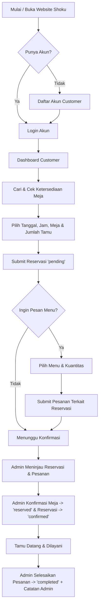
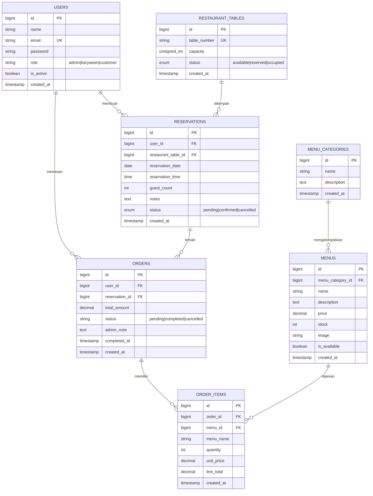

# Product Requirement Document (PRD) — Shoku Restaurant Reservation System

---

## 1. Ikhtisar Produk (Product Overview)

### 1.1 Latar Belakang & Deskripsi
**Shoku** adalah platform manajemen reservasi meja dan pemesanan menu restoran berbasis web. Sistem ini dirancang untuk memodernisasi proses operasional restoran konvensional dengan menghadirkan alur terintegrasi antara reservasi meja fisik, pemilihan hidangan lebih awal (*pre-order* makanan), dan kontrol operasional di sisi restoran (admin & staf).

### 1.2 Tujuan Produk (Goals & Objectives)
* **Mengeliminasi *Double Booking*:** Mencegah bentrok pemesanan meja pada interval waktu yang sama melalui validasi ketersediaan dinamis dan mekanisme *database locking*.
* **Efisiensi Alur Pesanan Tamu:** Memberikan kemudahan bagi pelanggan untuk mereservasi meja sekaligus memilih menu hidangan sebelum tiba di lokasi.
* **Sentralisasi Operasional Restoran:** Memudahkan pengelola restoran (Admin & Karyawan) mengelola meja fisik, katalog menu & stok, staf kerja, status reservasi tamu, serta pelaporan transaksi pesanan.
* **Transparansi & Riwayat Reservasi:** Menyediakan catatan riwayat reservasi dan status pesanan yang jelas bagi pelanggan maupun pihak restoran.

---

## 2. Sasaran Pengguna & Peran (User Roles & Personas)

Aplikasi memiliki 3 (tiga) peran pengguna utama dengan hak akses berbasis *role-based access control* (RBAC):

| Peran | Deskripsi | Akses Utama |
| :--- | :--- | :--- |
| **Customer (Pelanggan)** | Pengguna umum yang mendaftar secara mandiri untuk memesan meja dan memesan menu restoran. | Registrasi/Login, Katalog Menu, Cek Ketersediaan Meja, Buat Reservasi, Kelola Pesanan (*Pre-order*), Riwayat & Status. |
| **Admin (Pengelola Restoran)** | Pemilik atau pengelola utama operasional restoran yang memiliki kontrol penuh atas sistem. | Seluruh fungsi operasional: Manajemen Kategori & Menu, Meja Restoran, Staf Karyawan, Konfirmasi Reservasi, Penyelesaian Pesanan, dan Laporan Penjualan/Pendapatan. |
| **Karyawan (Staf Restoran)** | Staf operasional/lapangan yang bertugas memantau alur operasional restoran secara harian. | Dashboard pemantauan operasional harian restoran. |

---

## 3. Alur Pengguna Utama (User Journeys)

---

## 4. Persyaratan Fungsional (Functional Requirements)

### 4.1 Modul Autentikasi & Akun
* **FR-AUTH-01 (Registrasi):** Pelanggan dapat mendaftarkan akun baru dengan memasukkan nama, alamat email unik, dan kata sandi. Role otomatis ditetapkan sebagai `customer`.
* **FR-AUTH-02 (Login & Multi-Role Redirect):** Pengguna masuk dengan kredensial yang valid. Sistem mengarahkan pengguna ke dashboard yang sesuai berdasarkan perannya (`admin`, `karyawan`, atau `customer`).
* **FR-AUTH-03 (Proteksi Akun Nonaktif):** Pengguna dengan status `is_active = false` tidak dapat login dan menerima notifikasi bahwa akun telah dinonaktifkan.
* **FR-AUTH-04 (Logout & Session Security):** Sesi pengguna diakhiri secara aman saat melakukan logout dengan proteksi CSRF.

### 4.2 Modul Pelanggan (Customer Module)
* **FR-CUST-01 (Katalog Menu):** Pelanggan dapat melihat daftar menu makanan dan minuman yang aktif (`is_available = true`) beserta foto, deskripsi, kategori, harga, dan sisa stok.
* **FR-CUST-02 (Cek Ketersediaan Meja Realtime):** Fitur pencarian ketersediaan meja berdasarkan tanggal dan waktu yang dipilih melalui endpoint AJAX `customer.reservations.availability`.
* **FR-CUST-03 (Pemesanan Reservasi Meja):**
  * Pelanggan memilih tanggal (minimal hari ini), jam reservasi, meja restoran, jumlah tamu (maksimal sesuai kapasitas meja), dan catatan opsional.
  * Sistem melakukan validasi konflik reservasi pada rentang waktu yang berdekatan menggunakan transaksi database dan *locking* (`lockForUpdate`).
  * Reservasi baru berstatus awal `pending`.
* **FR-CUST-04 (Manajemen Riwayat Reservasi):** Pelanggan dapat melihat daftar reservasi yang pernah dibuat, detail reservasi, status terkini, serta membatalkan reservasi jika belum terlaksana.
* **FR-CUST-05 (Pemesanan Menu Terintegrasi / Pre-order):**
  * Pelanggan dapat membuat pesanan menu yang wajib dikaitkan dengan reservasi aktif yang dimiliki (`pending`, `confirmed`, `checked_in`).
  * Sistem memvalidasi ketersediaan stok menu secara atomik dan mengurangi stok saat pesanan berhasil disimpan.
* **FR-CUST-06 (Riwayat Pesanan):** Pelanggan dapat melihat status pesanan, rincian item pesanan, kuantitas, harga satuan, dan total tagihan.

### 4.3 Modul Admin (Admin Module)
* **FR-ADM-01 (Dashboard Metrik):** Menampilkan ringkasan data penting restoran, status meja, reservasi terbaru, dan pesanan aktif.
* **FR-ADM-02 (Manajemen Meja Restoran):**
  * CRUD nomor meja, kapasitas tempat duduk, dan status meja (`available`, `reserved`, `occupied`, `maintenance`).
* **FR-ADM-03 (Manajemen Kategori Menu):**
  * CRUD nama dan deskripsi kategori menu (contoh: Makanan Utama, Minuman, Hidangan Penutup).
* **FR-ADM-04 (Manajemen Menu & Stok):**
  * CRUD menu hidangan: nama, kategori, harga, stok bahan/porsi, upload gambar menu, serta penanda status ketersediaan (`is_available`).
* **FR-ADM-05 (Manajemen Staf Karyawan):**
  * Admin dapat membuat akun karyawan baru, mengedit data staf, dan mengaktifkan/menonaktifkan akun karyawan (`toggle is_active`).
* **FR-ADM-06 (Konfirmasi Reservasi Masuk):**
  * Admin memverifikasi reservasi yang berstatus `pending`.
  * Tindakan konfirmasi (`markTableReserved`) secara otomatis mengubah status reservasi menjadi `confirmed` dan status meja terkait menjadi `reserved` dalam satu transaksi aman.
* **FR-ADM-07 (Manajemen Pesanan & Pelunasan):**
  * Admin dapat meninjau seluruh pesanan masuk berserta rincian meja dan item pesanan.
  * Admin dapat menandai pesanan selesai (`orders.complete`), mencatat waktu penyelesaian (`completed_at`), dan menambahkan catatan khusus (`admin_note`).
* **FR-ADM-08 (Laporan Penjualan & Pendapatan):**
  * Penyaringan pesanan yang telah selesai berdasarkan rentang waktu: Harian (*day*), Mingguan (*week*), dan Bulanan (*month*).
  * Menghitung total volume pesanan dan agregasi total pendapatan (*revenue*).

### 4.4 Modul Karyawan (Staff Module)
* **FR-KRY-01 (Dashboard Karyawan):** Antarmuka pemantauan operasional yang dikhususkan bagi staf restoran untuk melihat aktivitas harian tanpa hak modifikasi konfigurasi sistem atau penghapusan data master.

---

## 5. Arsitektur Data & Entitas (Data Architecture)

---

## 6. Persyaratan Non-Fungsional (Non-Functional Requirements)

### 6.1 Keamanan (Security)
* **Injeksi SQL:** Seluruh interaksi basis data menggunakan Eloquent ORM atau parameter binding PDO.
* **IDOR / BOLA Prevention:** Pelanggan hanya dapat melihat, mengakses, dan membatalkan reservasi atau pesanan miliknya sendiri (`where user_id = Auth::id()`).
* **Proteksi CSRF:** Semua permintaan mutasi (*POST*, *PATCH*, *DELETE*) menyertakan token validasi `@csrf`.
* **Keamanan Kata Sandi:** Hashing kata sandi menggunakan standar algoritma Bcrypt via `Hash::make()`.
* **Kontrol Akses Berlapis:** Rute dilindungi oleh middleware `auth` dan pengecekan peran spesifik `role:admin`, `role:karyawan`, `role:customer`.

### 6.2 Integritas Data & Konkurensi (Concurrency & ACID)
* Penanganan pemesanan meja dan pengurangan stok menu dilakukan dalam blok `DB::transaction()` dengan *pessimistic locking* (`lockForUpdate()`) guna menghindari *race condition* jika dua pelanggan memesan meja atau item terakhir secara simultan.

### 6.3 Standar Desain & Antarmuka (UI/UX)
* Mengacu pada panduan desain Shoku (`AGENTS.md`):
  * **Brand Tokens:** Menggunakan CSS variables `--shoku-primary` (`rgb(255, 82, 50)`), `--shoku-secondary` (`#ffffff`), dan variasinya di `app.css`.
  * **Bahasa Salinan UI:** Bahasa Indonesia yang lugas dan berorientasi tindakan (*plain verbs*), bukan istilah teknis atau bahasa asing yang membingungkan.
  * **Aksesibilitas & Responsivitas:** Kompatibel di perangkat *mobile* (resolusi hingga ~360px), bebas *horizontal scroll*, dan memiliki kontras warna yang memenuhi standar WCAG AA.

### 6.4 Kinerja & Keandalan (Performance & Reliability)
* Menggunakan teknik *eager loading* (`with(['table', 'user', 'items'])`) untuk mencegah masalah kueri *N+1*.
* Pagination di seluruh daftar tabel berukuran besar (10-15 data per halaman).

---
